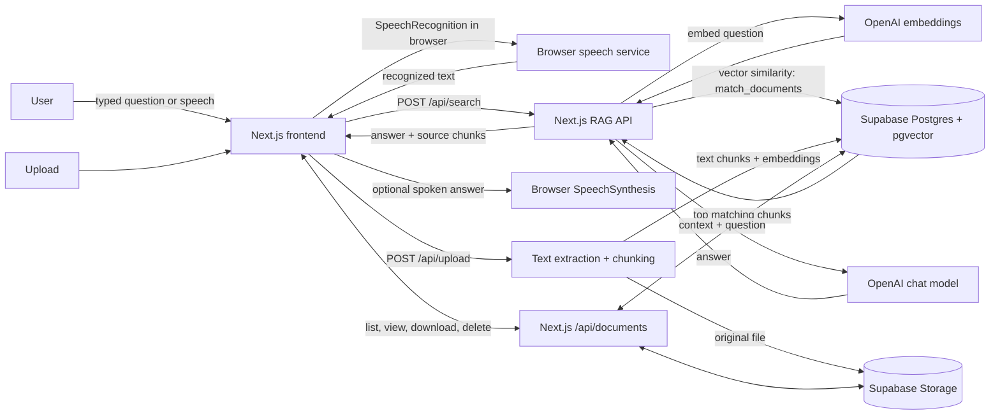

# RAG Search

RAG Search lets you ask questions about uploaded PDF, DOCX, and TXT files. It retrieves relevant passages from those files and uses them as context for an AI-generated answer, with source passages shown alongside the response.

## Technologies

- Next.js App Router, React, TypeScript, and Tailwind CSS
- Supabase Storage for original files and Supabase Postgres with pgvector for chunk text and embeddings
- OpenAI embeddings (`text-embedding-3-small`) and chat completions (`gpt-4o-mini`)
- Browser Speech Recognition for voice questions and browser Speech Synthesis for reading answers aloud (browser support varies)

## Architecture

The browser handles the interface and optional voice input/output. Voice recognition produces ordinary text; it then follows the same search path as a typed question. The server API retrieves document chunks from Supabase and asks OpenAI to compose an answer. The answer and matched source passages return to the browser.

## Run locally

Requirements: Node.js, an OpenAI API key, and a Supabase project configured with a `documents` Storage bucket, a `documents` table containing chunk content, metadata, and embeddings, and a `match_documents` Postgres function for vector search.

1. Install dependencies with `npm install`.
2. Copy `.env.example` to `.env.local` and fill in your values.
3. Start the development server with `npm run dev`.
4. Open [http://localhost:3000](http://localhost:3000).

Environment variables:

- `NEXT_PUBLIC_SUPABASE_URL`: Supabase project URL.
- `NEXT_PUBLIC_SUPABASE_PUBLISHABLE_DEFAULT_KEY`: Supabase publishable/anon key.
- `SUPABASE_SERVICE_ROLE_KEY`: optional server-side key used for Storage operations when row-level security requires it. Keep it private.
- `OPENAI_API_KEY`: server-side OpenAI key.

Never commit `.env.local` or real credentials. The `.env.example` file contains placeholders only.

## Error handling

API routes return JSON with an `error` message when an operation fails, and use HTTP error status codes for common failures. Upload reports file parsing, storage, and database errors; document operations report missing files/documents and database errors; search reports retrieval or OpenAI errors. The UI displays search and list errors, upload feedback, and voice-recognition issues such as blocked microphone access, no detected speech, or an unavailable browser speech service. Browser speech recognition availability and network requirements depend on the browser.

## Deployment and access

Do not deploy this as a public service until authentication, authorization, and request/usage limits are in place. The current API routes do not authenticate callers, so a public deployment could allow others to use your OpenAI account and access or modify stored documents. Configure secrets in the hosting provider’s environment settings; do not put them in Git.
